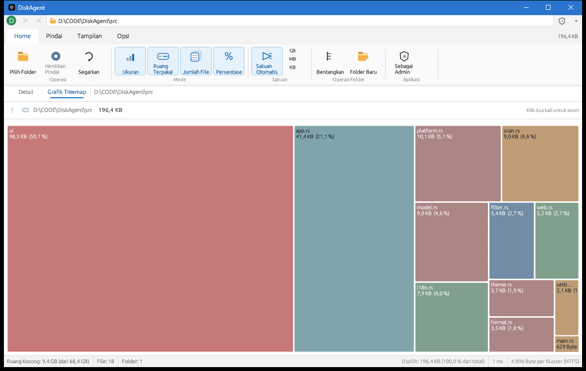
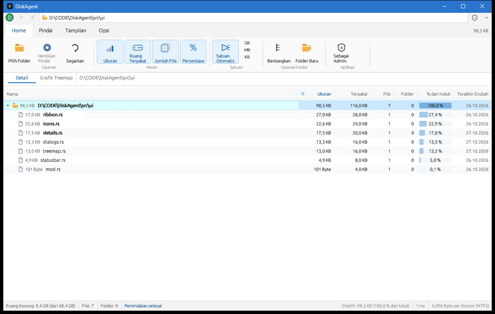

<div align="center">

# DiskAgent

**A lightweight TreeSize Free–style disk usage analyzer for Windows, built with Rust and egui.**

**Bahasa:** Indonesia · [English](README.en.md)

[](https://github.com/dimsyyy/DiskAgent/releases/latest/download/DiskAgent.exe)
[](#persyaratan-build)
[](https://www.rust-lang.org/)
[](https://github.com/emilk/egui)
[](Cargo.toml)
[](LICENSE)

[Unduh](#unduh) · [Fitur](#fitur) · [Screenshot](#screenshot) · [Instalasi](#instalasi) · [Build dari source](#build-dari-source) · [Penggunaan](#penggunaan) · [Keyboard](#keyboard-shortcut) · [Arsitektur](#arsitektur) · [Lisensi](#lisensi)

</div>

> **Status:** v0.1.0 — fitur inti sudah berjalan. Fitur lanjutan TreeSize Free belum termasuk.

## Unduh

[**Unduh DiskAgent.exe**](https://github.com/dimsyyy/DiskAgent/releases/latest/download/DiskAgent.exe) — Windows 10/11 64-bit.

Tidak perlu installer: unduh file, lalu jalankan. Semua versi tersedia di halaman [Releases](https://github.com/dimsyyy/DiskAgent/releases).

> [!NOTE]
> Binary rilis belum ditandatangani. Windows SmartScreen dapat menampilkan peringatan saat pertama dijalankan; pilih **More info → Run anyway** hanya jika kamu yakin file berasal dari halaman rilis resmi ini.

## Tentang

DiskAgent adalah aplikasi desktop Windows untuk melihat folder atau file mana yang menghabiskan ruang disk. Pilih sebuah folder, jalankan pemindaian, lalu telusuri hasilnya lewat **Details tree** atau **Treemap Chart**.

Aplikasi ini mengikuti alur dasar **TreeSize Free**:

- **Home** — mulai pemindaian, hentikan, refresh, dan buka folder.
- **Pindai** (Scan) — pemindaian rekursif dengan progress dan status.
- **Tampilan** (View) — Detail, Treemap, unit, kolom, dan sortir.
- **Opsi** (Options) — pilihan bahasa **English** dan **Bahasa Indonesia**.

DiskAgent bukan produk resmi TreeSize dan tidak memakai aset dari TreeSize. Semua ikon digambar sendiri dengan vektor.

## Screenshot



<p align="center"><sub><strong>Treemap Chart</strong> — proporsi ukuran folder dan file ditampilkan dalam kotak berukuran proporsional.</sub></p>

<details>
<summary><strong>Lihat tampilan Details</strong></summary>



</details>

## Fitur

| Kategori | Kemampuan |
| --- | --- |
| **Pemindaian** | Scan folder rekursif di background thread, UI tetap responsif, progress berjalan, dan scan bisa dihentikan. |
| **Details tree** | Kolom Name, Size, Allocated Space, Files, Folders, % of Parent, dan Last Modified. Mendukung expand/collapse, sortir, dan bar persentase. |
| **Treemap** | Tampilan *squarified* dengan warna per item, klik untuk memilih, klik dua kali untuk zoom ke folder, serta tombol Up/Root. |
| **Filter & pencarian** | Include/exclude mask, ukuran minimum, umur file, sembunyikan folder kosong, dan pencarian nama file/folder. |
| **Sortir & satuan** | Sortir dari header kolom atau combo, unit otomatis/TB/GB/MB/KB/B, dan jumlah desimal. |
| **File actions** | Buat folder baru, buka lokasi di Explorer, salin path, ekspor CSV, dan hapus permanen dengan konfirmasi. |
| **Folder Apa ini?** | Klik kanan folder/file untuk membuka Google Search dengan pertanyaan otomatis tentang fungsi dan keamanan item tersebut. |
| **Tampilan** | Ribbon, address bar, tombol navigasi, status bar, kolom yang bisa diatur, dan bahasa English/Indonesia. |
| **Windows integration** | Volume free space, cluster size, filesystem, elevated scan, dan restart sebagai Administrator. |

### Hapus permanen

Klik kanan file/folder di **Details** atau **Treemap**, pilih **Hapus permanen**, lalu konfirmasi. Item langsung dihapus dan **tidak masuk Recycle Bin**. Folder root yang sedang dipindai tidak dapat dihapus.

### Folder Apa ini?

Klik kanan folder/file, lalu pilih **Folder Apa ini?** atau **File Apa ini?**. DiskAgent akan membuka browser default ke Google Search dengan pertanyaan seperti:

> Apa fungsi folder “node_modules” di “CODE\project” dan apakah aman dihapus?

Query memakai nama item dan maksimal tiga komponen lokasi terakhir. Nama user Windows disamarkan, dan isi file tidak dikirim.

> [!NOTE]
> Google AI Overview tidak selalu muncul. Hasil bisa berupa artikel, forum, atau dokumentasi biasa. Fitur ini membutuhkan koneksi internet dan membuka layanan pihak ketiga.

## Instalasi

Ada dua cara menjalankan DiskAgent:

- **Unduh binary** — cara tercepat, tidak perlu Rust.
- **Build dari source** — lihat bagian [Build dari source](#build-dari-source).

### Unduh binary

1. Buka halaman [Releases](https://github.com/dimsyyy/DiskAgent/releases) atau klik tombol **Unduh** di bagian atas.
2. Unduh `DiskAgent.exe`.
3. Jalankan langsung; tidak perlu installer.

### Persyaratan build

- Windows 10/11 64-bit.
- [Rust](https://rustup.rs/) stable dengan edition 2021.
- Salah satu linker:
  - **MSVC** — Visual Studio Build Tools dengan workload *Desktop development with C++* (disarankan), atau
  - **MinGW-w64** — `x86_64-w64-mingw32-gcc` tersedia di `PATH`.

## Build dari source

Setelah repositori di-clone:

```bat
cd DiskAgent
cargo build --release
```

Binary hasil build:

```text
target\release\DiskAgent.exe
```

Untuk build debug:

```bat
cargo build
target\debug\DiskAgent.exe
```

### Menggunakan toolchain MSVC

```bat
rustup default stable-x86_64-pc-windows-msvc
cargo build --release
```

### Menggunakan toolchain GNU / MinGW-w64

Pastikan MinGW-w64 sudah terpasang dan folder `bin`-nya ada di `PATH`. Contoh:

```bat
rustup default stable-x86_64-pc-windows-gnu
set PATH=%USERPROFILE%\.cargo\bin;C:\mingw64\bin;%PATH%
cargo build --release
```

## Menjalankan

Jika mengunduh dari Releases, cukup jalankan `DiskAgent.exe` dari folder unduhan.

Jalankan aplikasi tanpa argumen:

```bat
target\release\DiskAgent.exe
```

Atau langsung memindai folder tertentu:

```bat
target\release\DiskAgent.exe "D:\Data"
```

## Penggunaan

1. Klik **Pilih Folder** / **Select Directory**, atau masukkan path di address bar.
2. Tunggu pemindaian selesai. Progress dan status muncul di bagian bawah; pemindaian bisa dihentikan kapan saja.
3. Gunakan tab **Detail** untuk melihat tabel ukuran dan **Grafik Treemap** untuk melihat proporsi visual.
4. Gunakan **Filter** atau `Ctrl+F` untuk mempersempit hasil.
5. Klik kanan item untuk membuka Explorer, menyalin path, menghapus permanen, atau mencari penjelasan di Google.
6. Buka **Opsi → Bahasa** untuk mengganti bahasa antarmuka.

### Pengaturan

Pengaturan disimpan otomatis di:

```text
%APPDATA%\DiskAgent\settings.json
```

Yang disimpan: bahasa, unit, jumlah desimal, kolom yang terlihat, sortir, opsi hide-empty, status ribbon, dan folder terakhir. Filter yang sedang aktif tidak disimpan.

Hapus file tersebut untuk kembali ke pengaturan default.

## Keyboard shortcut

| Tombol | Aksi |
| --- | --- |
| `↑` / `↓` | Pindah baris terpilih |
| `→` | Expand folder / pindah ke anak pertama |
| `←` | Collapse folder / pindah ke folder induk |
| `Enter` | Expand atau collapse folder terpilih |
| `Home` / `End` | Ke baris pertama / terakhir |
| `PageUp` / `PageDown` | Geser seleksi 20 baris |
| `Ctrl+F` | Buka pencarian |
| `Ctrl+C` | Salin path item terpilih |
| `Esc` | Tutup menu/popup |

Klik dua kali pada folder akan expand/collapse. Klik dua kali pada file akan memilih file tersebut di Explorer.

## Arsitektur

```text
src/
├── main.rs          # Entry point eframe
├── app.rs           # State aplikasi, aksi, keyboard, penyimpanan settings
├── scan.rs          # Scanner rekursif di background thread
├── model.rs         # Node, ScanTree, agregasi, penghapusan subtree
├── filter.rs        # Wildcard filter dan ViewStats
├── format.rs        # Format byte, jumlah item, persen, unit
├── platform.rs      # FFI Windows, volume, elevation, delete, open URL
├── web.rs           # Query Google dan URL encoding
├── i18n.rs          # Terjemahan English/Indonesia
├── settings.rs      # Persistensi settings JSON
├── theme.rs         # Warna dan style
└── ui/
    ├── ribbon.rs    # Tab, grup tombol, address bar
    ├── details.rs   # Tabel virtualized dan interaksi baris
    ├── treemap.rs   # Squarified treemap
    ├── statusbar.rs # Status bar
    ├── dialogs.rs   # Filter, columns, new folder, delete, search
    └── icons.rs     # Ikon vektor
```

### Teknologi

| Komponen | Teknologi |
| --- | --- |
| GUI | [eframe](https://github.com/emilk/eframe) 0.29 + [egui](https://github.com/emilk/egui) dengan backend OpenGL (glow) |
| File dialog | [rfd](https://github.com/PolyMeilex/rfd) |
| Settings | serde + serde_json |
| Scanner | `std::fs` + background thread + channel/atomic progress |
| Windows API | FFI manual untuk volume, elevation, ShellExecute, dan timestamp |

## Roadmap

- [x] Scan folder rekursif dengan progress dan cancellation.
- [x] Details tree, treemap, filter, pencarian, sortir, dan unit.
- [x] Bahasa English/Indonesia dan settings persisten.
- [x] Hapus permanen, pembuatan folder, buka Explorer, dan ekspor CSV.
- [x] Integrasi Google Search untuk **Folder Apa ini?**.
- [x] Rilis binary v0.1.0 di GitHub Releases.
- [ ] Fitur lanjutan TreeSize Free (scheduled scan, duplicate finder, file age, top files).
- [ ] Installer Windows dan ikon aplikasi kustom.
- [ ] CI dan lebih banyak unit test.

## Batasan

- Pemindaian memakai recursive filesystem walk, bukan pembacaan langsung MFT NTFS. Volume yang sangat besar bisa lebih lambat dibanding tools khusus NTFS.
- Allocated size dihitung berdasarkan cluster size volume; hasilnya bisa berbeda pada kondisi kompresi, enkripsi, atau reparse point tertentu.
- Fitur lanjutan seperti scheduled scan, duplicate finder, dan analisis umur file belum tersedia.
- **Hapus permanen tidak melalui Recycle Bin.** Backup data penting sebelum menghapus.
- **Folder Apa ini?** bergantung pada Google dan koneksi internet; hasilnya bukan jaminan bahwa item aman dihapus.
- Binary rilis belum ditandatangani, jadi Windows SmartScreen bisa menampilkan peringatan saat pertama dijalankan.

## Kontribusi

Kontribusi terbuka untuk perbaikan bug, dokumentasi, terjemahan, dan fitur baru yang masih dalam ruang lingkup aplikasi.

Sebelum mengirim pull request:

```bat
cargo fmt
cargo test
cargo build --release
```

Untuk perubahan besar, sebaiknya buka issue atau diskusi terlebih dahulu agar arah implementasinya jelas.

## Lisensi

Dirilis di bawah [MIT License](LICENSE).

## Penghargaan

- Terinspirasi oleh **TreeSize Free** dari JAM Software. DiskAgent tidak berafiliasi dengan JAM Software.
- Dibangun dengan Rust, egui/eframe, rfd, dan serde.
- Semua ikon antarmuka digambar sendiri dengan vektor.

---

<p align="center"><sub>Dibuat untuk membantu menjawab pertanyaan: “Folder apa ini, dan seberapa besar ruang yang dipakainya?”</sub></p>
